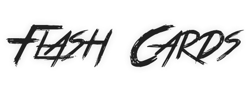
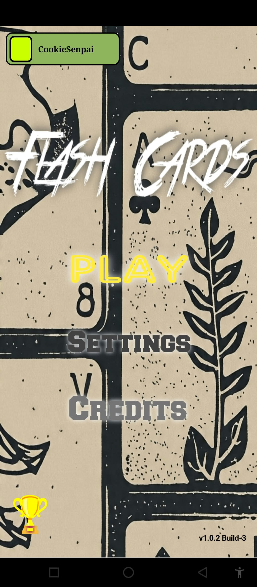
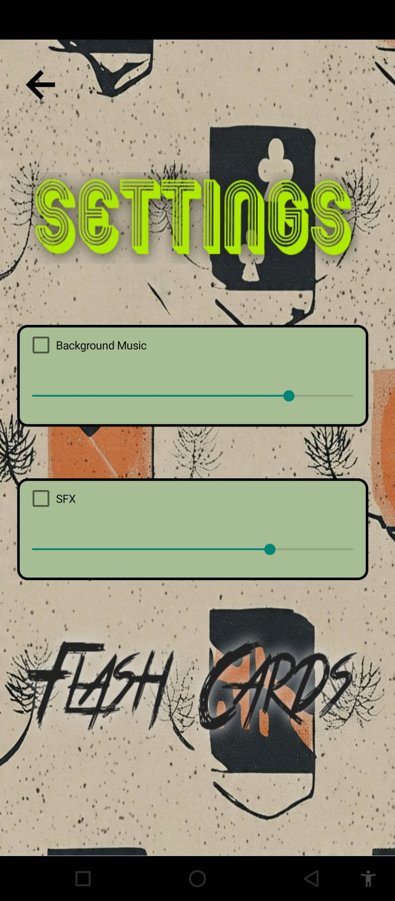
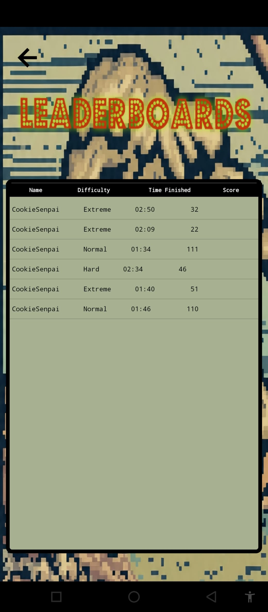
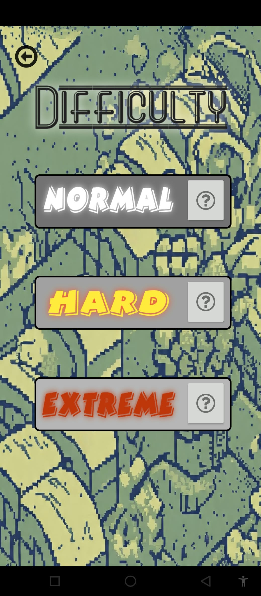
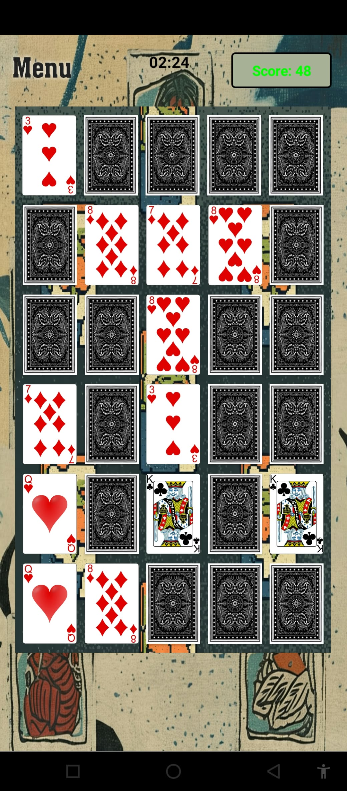

  

<h1 align="center">Flash Cards Game</h1>

  A classic matching card game with a little twist

  
  
  

## 📖 About the Project
**Flash Cards** is a game adapted from a classic matching image game with a little twist

The game has 3 difficulty levels (Normal/Hard/Extreme)
- **Normal** -  Experience classic card-matching gameplay with a time limit of 3 minutes. Find all matching pairs before time runs out.
- **Hard** - A more challenging version of Normal Mode. Every 40 seconds, one previously matched pair is flipped back over and relocated to a random position on the board. Players have 4 minutes to find all matching pairs.
- **Extreme** -  The ultimate memory challenge. Similar to Hard Mode, previously matched cards are flipped back over. However, every 60 seconds, all undiscovered cards are reshuffled to new positions, making it even harder to remember their locations. Players have 5 minutes to complete the game.

## ✨ Extra Features
**Game History** – Keeps a record of completed games, allowing players to review and compare their previous game results.   
**Background Music & Sound Effects (BGM/SFX)** – Features different background music tracks for each difficulty level, along with sound effects to create a more immersive gaming experience.  
**Local Game Data Storage** – Automatically saves player game data locally, preserving game history even after closing the application.

## 📸 Screenshots
### Main Menu

  

### Audio Settings

  

### Game History

  

### Difficulty Selection

  

### Gameplay

  

 ## 📥 Download
 Get the latest available version of Flash Cards:  
[**⬇️ Download Flash Cards v1.0.2**](https://drive.google.com/file/d/1ORFcrp8ORxH-rE9JgjIIRV_CxweyzG9C/view?usp=drive_link) 

## 📌 Ownership & Credits Clarification
This game was originally developed as a commissioned school project. As agreed upon by the clients, the creator retains full ownership of the entire source code and its associated intellectual property.

The names displayed on the in-game credits page are included solely for acknowledgment and verification purposes as part of the school's project requirements. Their appearance in the credits does not imply ownership or authorship of the source code.

  <a href="#top">⬆ Back to Top</a>

